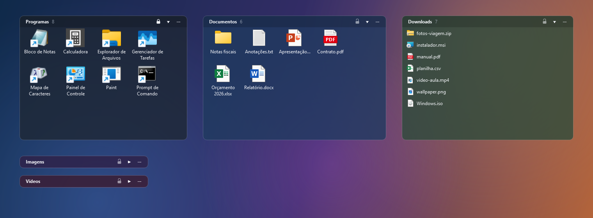

# BoxDesktop — Caixas Desktop

**Organize a área de trabalho do Windows com caixas ligadas a pastas.**
Cada caixa é uma área semitransparente no desktop que mostra o conteúdo de uma pasta real:
o que você arrasta para a caixa vai para a pasta, e o que entra na pasta aparece na caixa.

## ⬇️ Download

Baixe o instalador na página de **[Releases](../../releases)**:
**`CaixasDesktop-Setup-<versão>.exe`**.

- Windows 10 ou 11, 64 bits
- Instala em `C:\Program Files\Caixas Desktop` e pede permissão de administrador
- Fica em **Configurações → Aplicativos** para desinstalar quando quiser
- Programa e instalador em 9 idiomas: português, inglês, espanhol, francês, alemão, italiano,
  japonês, chinês simplificado e russo

> O instalador ainda não é assinado digitalmente. Se o Windows mostrar "O Windows protegeu o
> computador", clique em **Mais informações → Executar assim mesmo**.

## ✨ Recursos

- **Caixas ligadas a pastas.** Use uma pasta nova ou uma que já existe, inclusive pastas ocultas
  do Desktop. Arraste para dentro para mover, ou segure **Ctrl** para copiar.
- **Ícones ou lista**, com tamanho dos ícones, cor e opacidade ajustáveis.
- **Atalhos com ícone de verdade**, inclusive os `.url` da Steam e da Epic.
- **🔒 Cadeado** na barra de título para travar a posição e o tamanho.
- **Recolher a caixa** até ficar só a barra de título. Ela abre sozinha quando o mouse passa por cima.
- **Caixa selecionada fica por cima** das outras janelas e volta para o desktop ao clicar fora.
  As caixas também não somem com Win+D e não aparecem no Alt+Tab.
- **Regras automáticas:** arquivos que aparecem no Desktop vão sozinhos para a caixa certa. As
  regras podem ser por tipo, extensão, nome com curinga, "nome contém" ou expressão regular. Tem
  pré-visualização e **Desfazer**.
- **Perfis por monitor:** cada combinação de monitores e resoluções guarda o seu próprio layout.
  Ao tirar o notebook da dock, as caixas se reorganizam, e ao voltar o layout é restaurado.
- **Iniciar com o Windows**, ícone na bandeja e **Ctrl+Alt+H** para mostrar ou ocultar todas as
  caixas.
- **Janela de Configurações** com as abas Geral, Aparência, Caixas, Regras automáticas, Monitores
  e Sobre.
- **9 idiomas:** o programa abre no idioma escolhido na instalação, ou no do Windows, e dá para
  trocar o idioma em Configurações sem reiniciar.

## 🧭 Como usar

1. Depois de instalar, o ícone de **4 quadradinhos coloridos** aparece na bandeja, perto do relógio.
2. Clique com o botão direito → **Nova caixa…** e escolha a pasta que ela vai mostrar.
3. Arraste a caixa pela barra de título e redimensione pelas bordas. O botão **⋯** abre as opções.
4. Em **Configurações…**, no menu da bandeja, você ajusta o idioma, a aparência, as caixas, as
   regras automáticas e os monitores.

Suas caixas e configurações ficam em `%APPDATA%\CaixasDesktop`. Desinstalar não apaga essa pasta
nem as pastas das caixas.

---

### English

**Caixas Desktop** is a Windows desktop organizer: semi-transparent boxes on the desktop, each
linked to a real folder. It includes auto-sorting rules, per-monitor layout profiles, a position
lock, roll-up boxes, a settings window and start-with-Windows. The app and the installer are
available in 9 languages (English, Portuguese, Spanish, French, German, Italian, Japanese,
Simplified Chinese and Russian). Download the installer from **[Releases](../../releases)**.

---

© AjncSystemIA. Distribuído apenas como instalador; o código-fonte não está publicado.
